<div align="center">

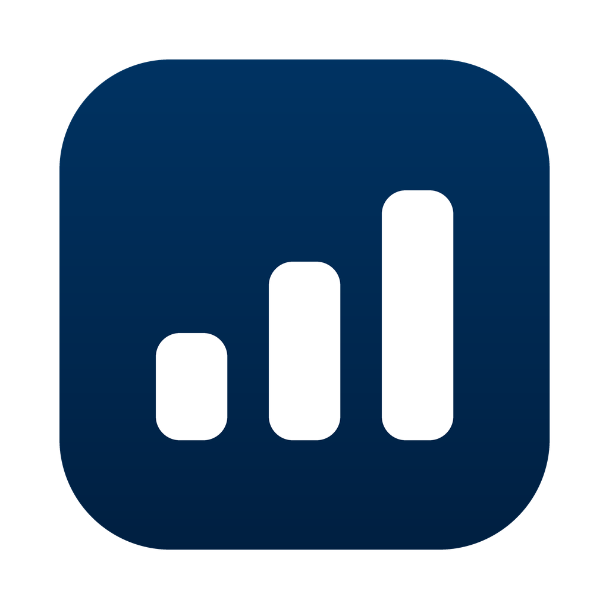

# Budget

**A calm, private budget app for your Mac.**

Plan every euro, see what's left at a glance, and know whether your savings will hold up in the year ahead.

No account. No subscription. No cloud. Your data stays on your Mac.

</div>

<br>

<picture>
  <source media="(prefers-color-scheme: dark)" srcset="docs/screenshots/overview-dark.png">
  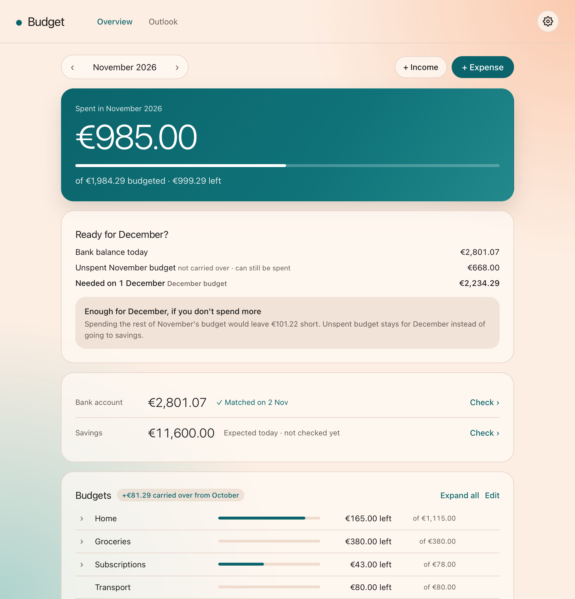
</picture>

<p align="center"><sub>All screenshots show the real app with made-up data.</sub></p>

## What it does

### See your month at a glance

Your spending, what's left in each budget, and anything spent outside your budgets, all on one page. Budgets go red only when you've overspent, so the page stays calm until something needs your attention.

**Look back on a finished month.** Go back to an earlier month and the top card shows how it went: income, spending, the result, budgets that went over, and what was carried over or saved.

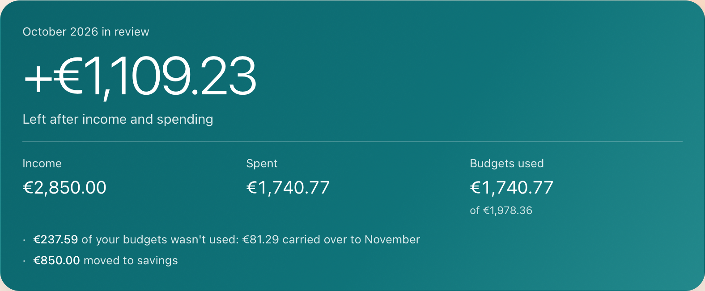

**Ready for next month?** In the last week of the month, Budget compares your bank balance, plus the income you still expect this month, with what next month needs and tells you exactly how much is short or spare. Once your income is in, one click moves the difference to or from your savings.

### Budgets that fit real life

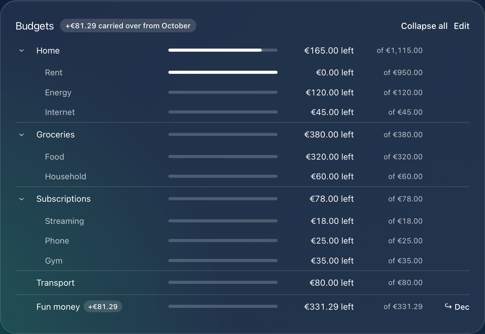

- **Categories and items**, such as Home › Rent, Energy and Internet, or a single budget like Fun money.
- **Budgets that change over time.** Raise the rent from next month and earlier months stay exactly as they were.
- **Carry leftovers over** to next month, by default or case by case, and see how much came along.

### Add a transaction and see the effect first

<table>
<tr>
<td width="50%">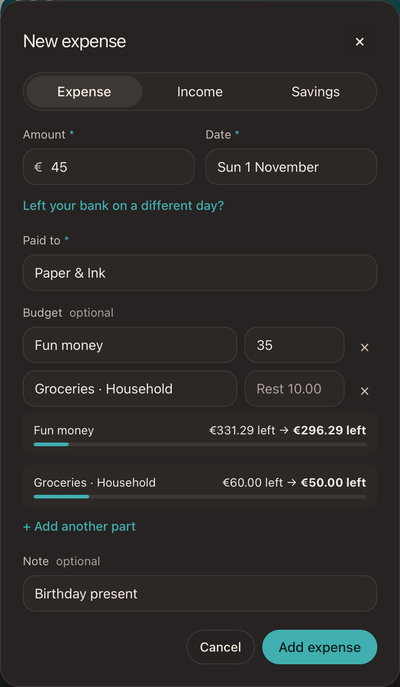</td>
<td>

- **Split** one purchase across several budgets.
- **See the effect before you save:** a preview shows what's left in each budget, in red if it would go over.
- **Income** can top up a budget. Sold something online? Add it to your Fun money.
- **Bills paid in advance** can count for one month and leave your bank in another.
- **Quick entry:** known payees suggest the budget you used last time, and pressing <kbd>N</kbd> or <kbd>I</kbd> opens a new expense or income.

</td>
</tr>
</table>

### Import from your bank

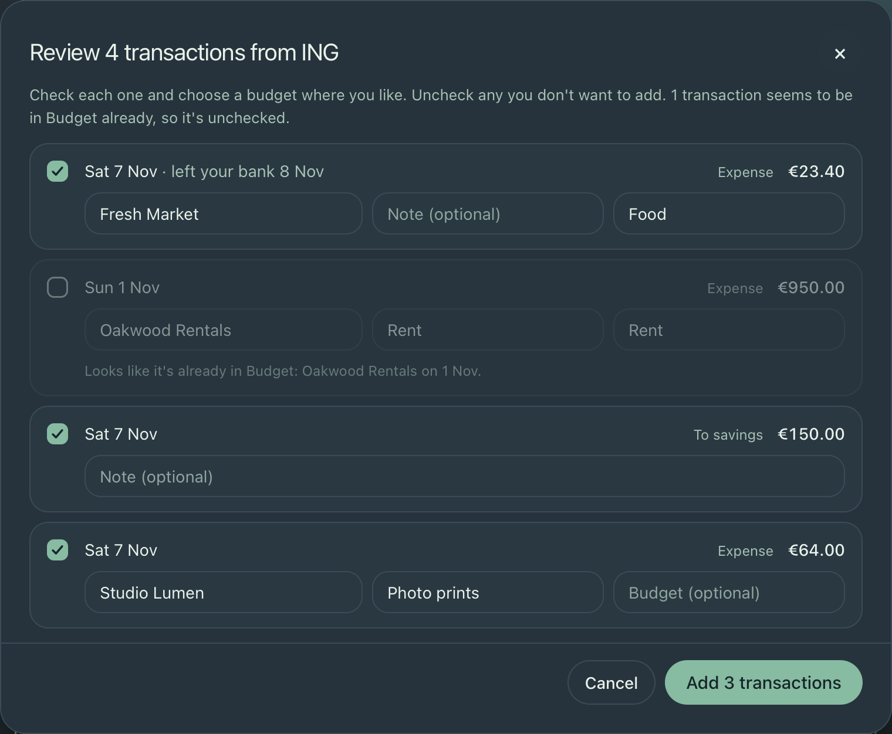

Export your transactions from your bank as CSV and choose **Import** above your transactions. Budget fills in every transaction: the date you paid and the day it left your bank, the payee, the note, and savings transfers. Payees you've paid before get the name and budget you used last time. You review each one before anything is added, and transactions that look like they're already in Budget are unchecked, so nothing is added twice.

Budget reads exports from ING (Netherlands) for now. Each bank has its own small reader, so more banks can be added.

### Find anything

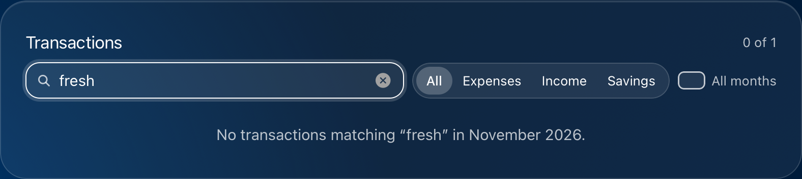

Transactions are grouped per day. Search by payee, note, budget or amount, filter by type, and search across all months. Click a budget to see only its transactions, or select several to delete them at once.

### Keep your balances honest

<table>
<tr>
<td>

Set a starting balance for your bank account and savings, and Budget keeps track from there. Enter what your bank shows at any time: it tells you whether everything matches, or how much is off.

Follow the development of your savings through the year, month by month.

</td>
<td width="50%">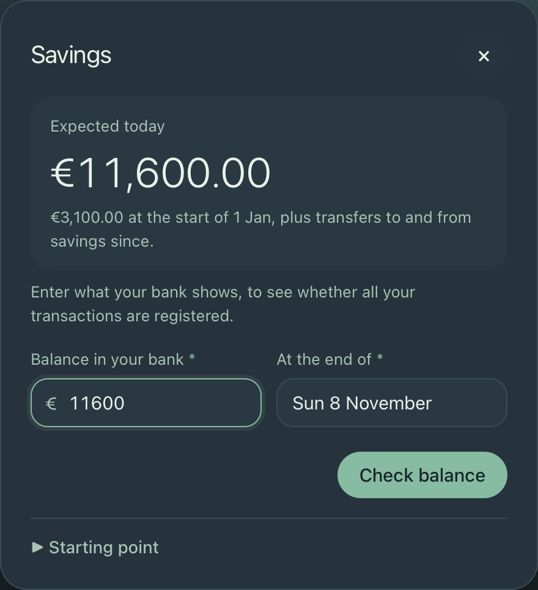</td>
</tr>
</table>

### Look ahead with the Outlook

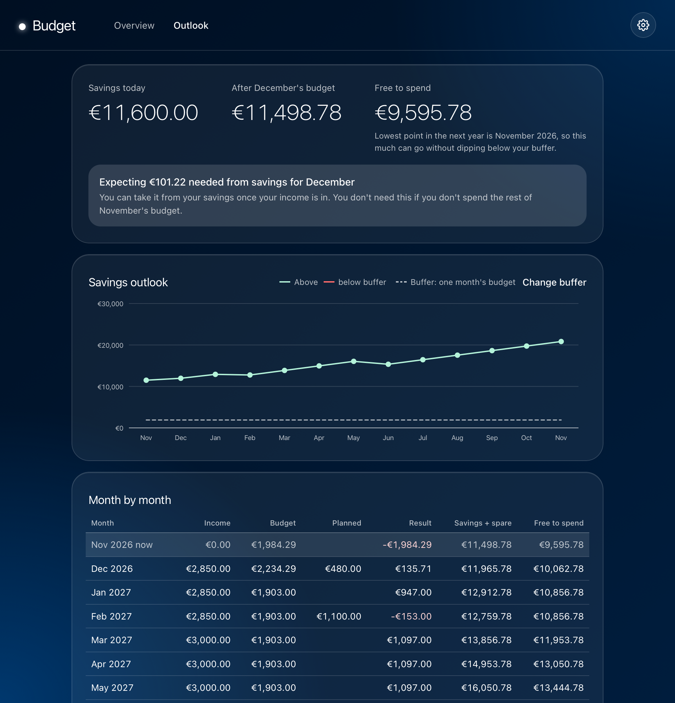

Add your expected income and planned costs, like a holiday or a new laptop, and Budget projects your savings for the next 12 months. If your bank account won't cover next month's budget, it tells you how much to take from your savings. It keeps a safety buffer in your savings and shows how much you can **freely spend** without dipping below it in any month ahead. The chart marks the lowest point ahead, so you can see where that amount comes from, and small bars show what each month adds or takes. You choose the buffer: a number of months of budget, or a fixed amount.

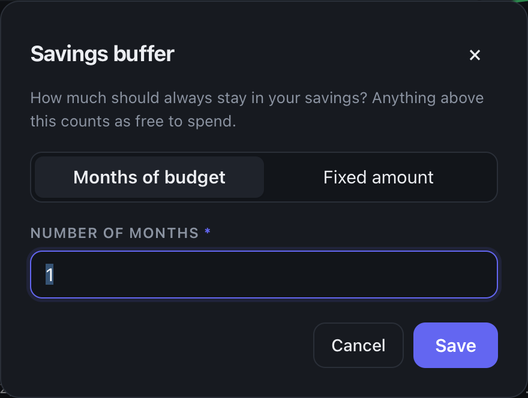

### Make it yours

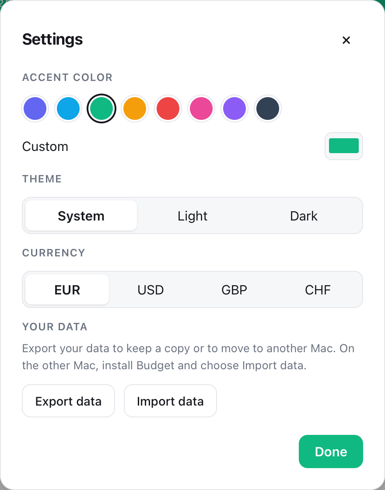

Follow your Mac's light or dark mode, or choose one yourself, and pick your currency from every currency in the world.

### Take your data with you

Export everything to a single file, to keep your own copy or to move to a new Mac. Importing is made to be safe: Budget checks the file first, shows what's in it and what it replaces, and keeps a safety copy so you can undo the import.

## Installing

1. Download `Budget.dmg` from the [Releases](../../releases) page.
2. Open it and drag **Budget** to **Applications**.
3. Open Budget. Nothing else needs to be installed.

> [!NOTE]
> Budget isn't signed with an Apple Developer account yet, so macOS blocks the first start. Open **System Settings → Privacy & Security** and choose **Open Anyway**. You only need to do this once.

Budget currently runs on Macs with Apple Silicon.

## Your data

Everything stays on your Mac. Budget makes a backup automatically once a day and keeps the last 14 days, in `~/Library/Application Support/nl.hendrikdemir.budget/backups`.

**Moving to a new Mac**

1. On your old Mac, open Budget, click the gear icon to open **Settings**, and choose **Export data**. Save the file.
2. Move the file to your new Mac, for example with AirDrop.
3. Install Budget on your new Mac, open **Settings**, and choose **Import data**.

The export file holds all your financial data and isn't encrypted, so keep it somewhere safe and delete it when you no longer need it.

## For developers

Budget is a small Python and JavaScript app. It uses SQLite and only the Python standard library, with no web build step.

Run it from source in your browser, with separate data in this folder:

```bash
python3 server.py
```

Then open http://localhost:8000.

Add `--demo` to try it with a made-up household, kept in `.demo-data/`.

Build `dist/Budget.app` and `dist/Budget.dmg`:

```bash
packaging/build.sh
```

Build and replace the copy in Applications (your data isn't affected):

```bash
packaging/install.sh
```

Run the tests:

```bash
python3 -m unittest
```

Update the screenshots, using made-up data:

```bash
.venv-build/bin/python packaging/make_screenshots.py
```

| Path | Contents |
| --- | --- |
| `desktop.py` | The Mac app: starts the server and opens the window |
| `server.py` | Starts the server for development |
| `app/` | Server side: database, budgets, balances, outlook, bank imports, backups and API |
| `static/` | The page: HTML, CSS and JavaScript modules |
| `packaging/` | App build, icon and screenshots |
| `tests/` | Tests for the calculations, bank imports and the server |
