<div align="center">

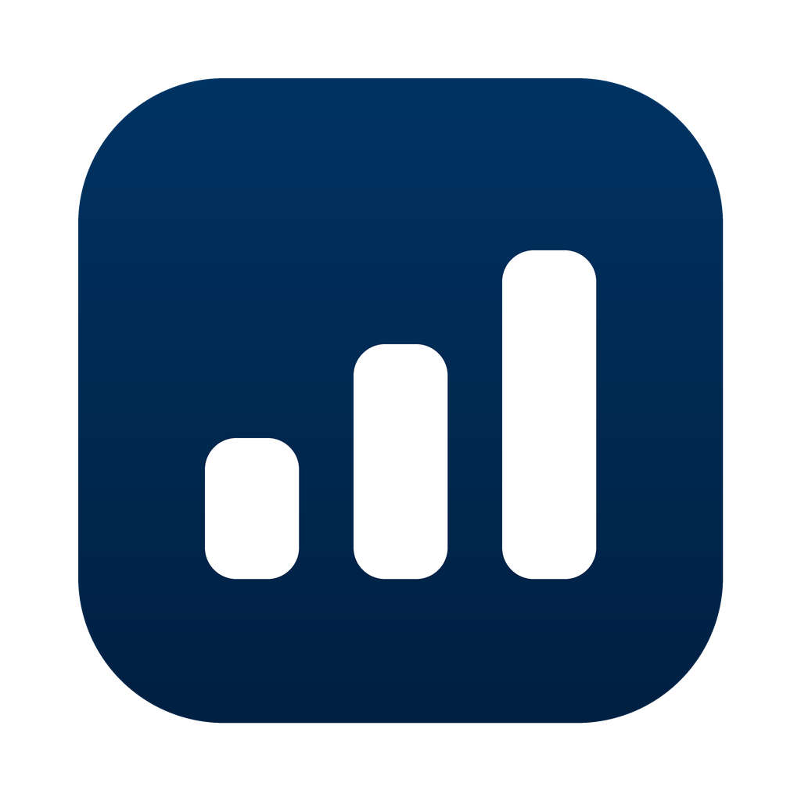

# Budget

**A calm, private budget app for Mac and Windows.**

Plan every euro, see what's left at a glance, and know whether your savings will hold up in the year ahead.

Starts simple, even if you've never kept a budget, and grows with you. In English or Dutch.

No account. No subscription. No cloud. Your data stays on your computer.

</div>

<br>

<picture>
  <source media="(prefers-color-scheme: dark)" srcset="docs/screenshots/overview-simple-dark.png">
  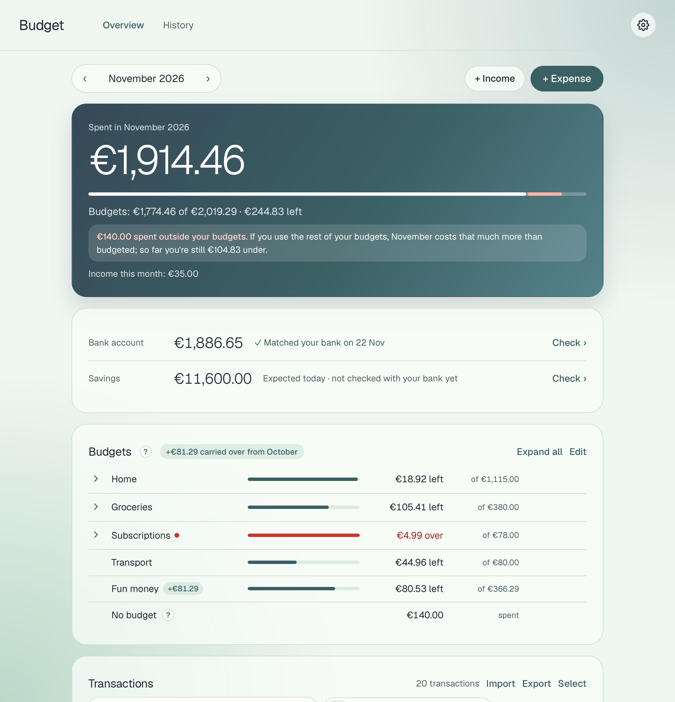
</picture>

<p align="center"><sub>All screenshots show the real app with made-up data.</sub></p>

## Start simple

A new Budget shows just what you need to keep a budget: what you plan to spend, what you spent, and what's left. Never kept a budget before? Small **?** buttons explain every word in plain language.

### Start from your income

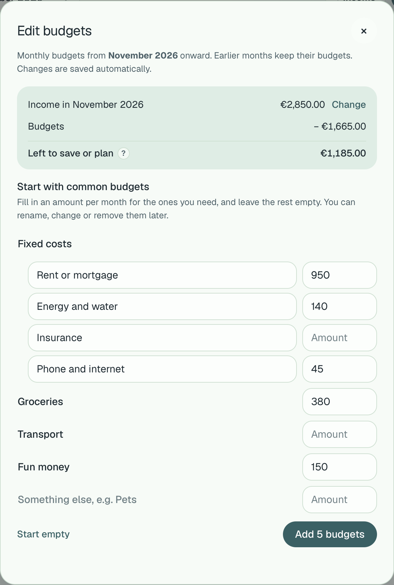

Enter what comes in each month, then give each kind of spending an amount: Budget suggests a few common ones, so you only fill in amounts. It shows straight away whether your budgets fit your income, and what's left to save.

### See your month at a glance

Your spending, what's left in each budget, and anything spent outside your budgets, all on one page. Budgets go red only when you've overspent, so the page stays calm until something needs your attention.

**Look back on a finished month.** Go back to an earlier month and the top card shows how it went: income, spending, the result, and budgets that went over.

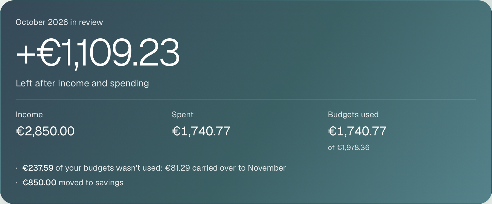

### Add what you spend

<table>
<tr>
<td width="50%">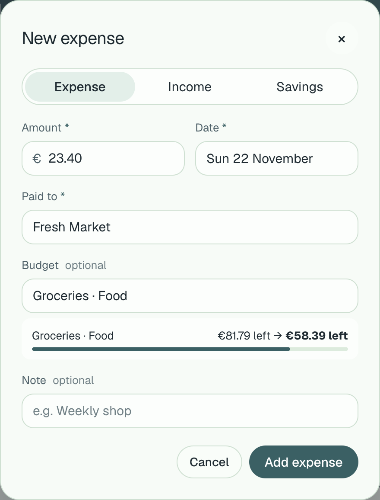</td>
<td>

- **See the effect before you save:** what's left in the budget, in red if it would go over.
- **Quick entry:** known payees suggest the budget you used last time.
- **Income** can top up a budget. Sold something online? Add it to your Fun money.

</td>
</tr>
</table>

### Import from your bank

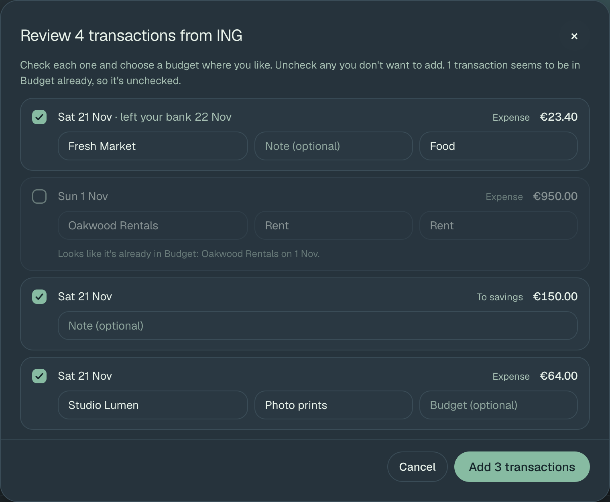

Export your transactions from your bank as CSV and choose **Import** above your transactions. Budget fills in every transaction: the date you paid and the day it left your bank, the payee, the note, and savings transfers. Payees you've paid before get the name and budget you used last time. You review each one before anything is added, and transactions that look like they're already in Budget are unchecked, so nothing is added twice.

Budget reads exports from ING (Netherlands) for now. Each bank has its own small reader, so more banks can be added. It also reads its own CSV exports, with their budgets and splits, for example to move transactions between two copies of Budget.

### Find anything

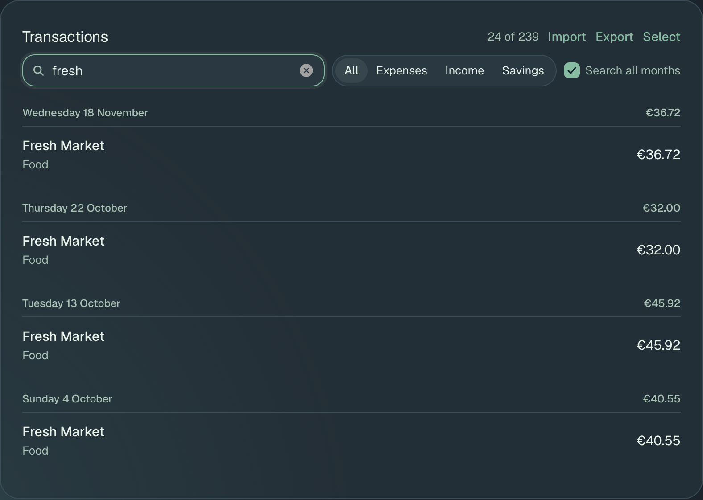

Transactions are grouped per day. Search by payee, note, budget or amount, filter by type, and search across all months. Click a budget to see only its transactions, or select several to export or delete them at once.

**Export to a spreadsheet.** **Export** above your transactions saves the ones in the list (the month, or what your search shows) or all transactions as a CSV file. A transaction split over budgets gets a row per budget, so a spreadsheet can total each budget.

### Look back with History

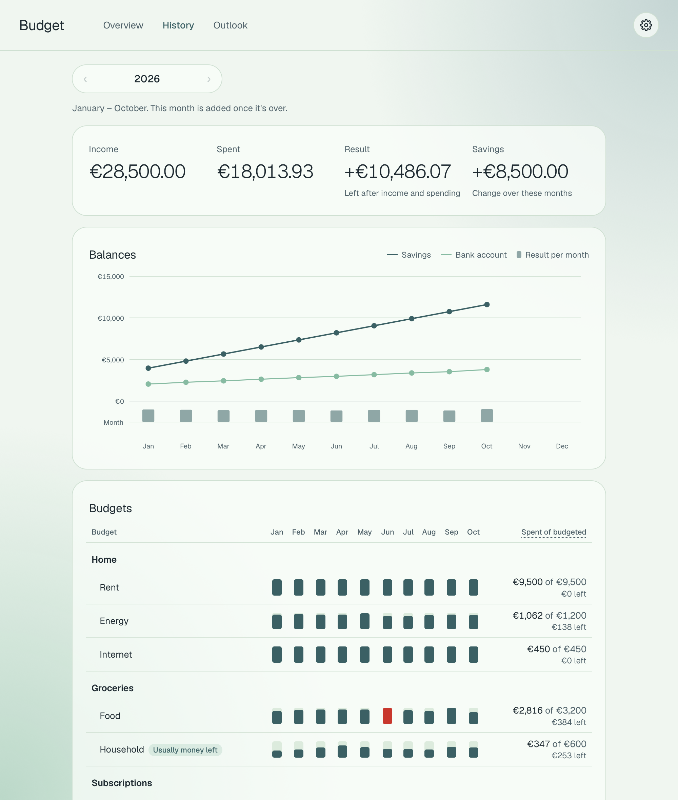

The History page shows a year at a glance: what came in, what went out and what was left, and how your bank account and savings developed, month by month. It starts at your starting balance (or, without one, at your first transaction), so months before you began keeping track aren't shown.

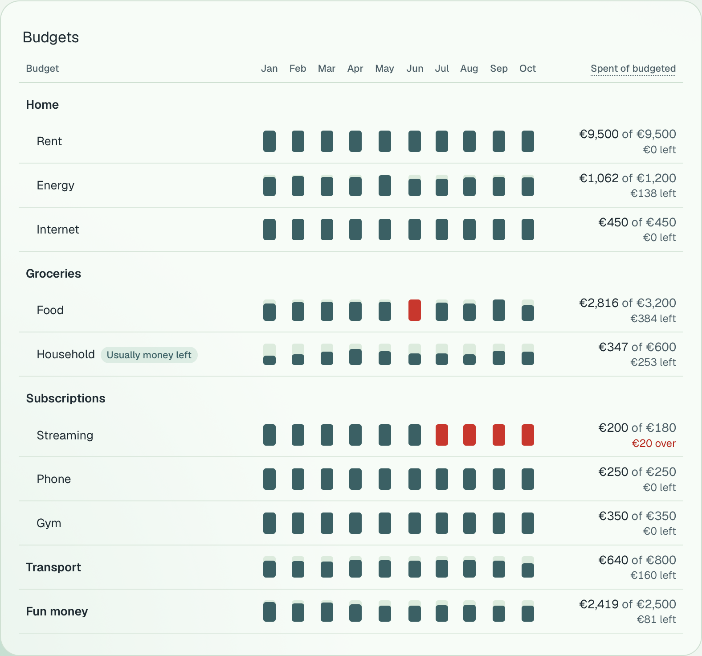

**See how your budgets held up.** For each budget, a small bar per month shows how much of it was spent, in red when it went over. Point at a month for what was left or overspent. Budgets that are usually over, or usually have a lot left, are marked, so you can see which ones need a different amount. Spending outside your budgets has its own row.

### It grows with you

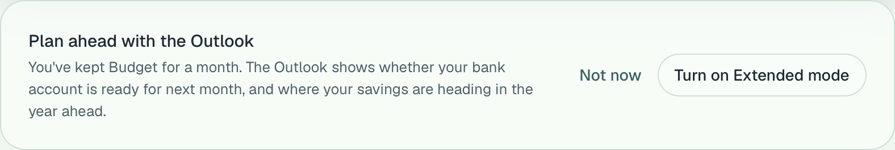

When something more becomes useful, Budget offers it, one thing at a time, and **Not now** puts it away:

- **Keep your bank balance** once you've used Budget for a couple of weeks or added income, so it can tell you when a transaction is missing.
- **Track your savings** once you move money to or from them.
- **The Outlook** once you've kept Budget for a month.
- **Carry leftovers over** when a budget had money left two months in a row.

## Extended mode: everything, when you're ready

Choose **Extended** in Settings, or accept an offer, and Budget shows every feature.

<picture>
  <source media="(prefers-color-scheme: dark)" srcset="docs/screenshots/overview-dark.png">
  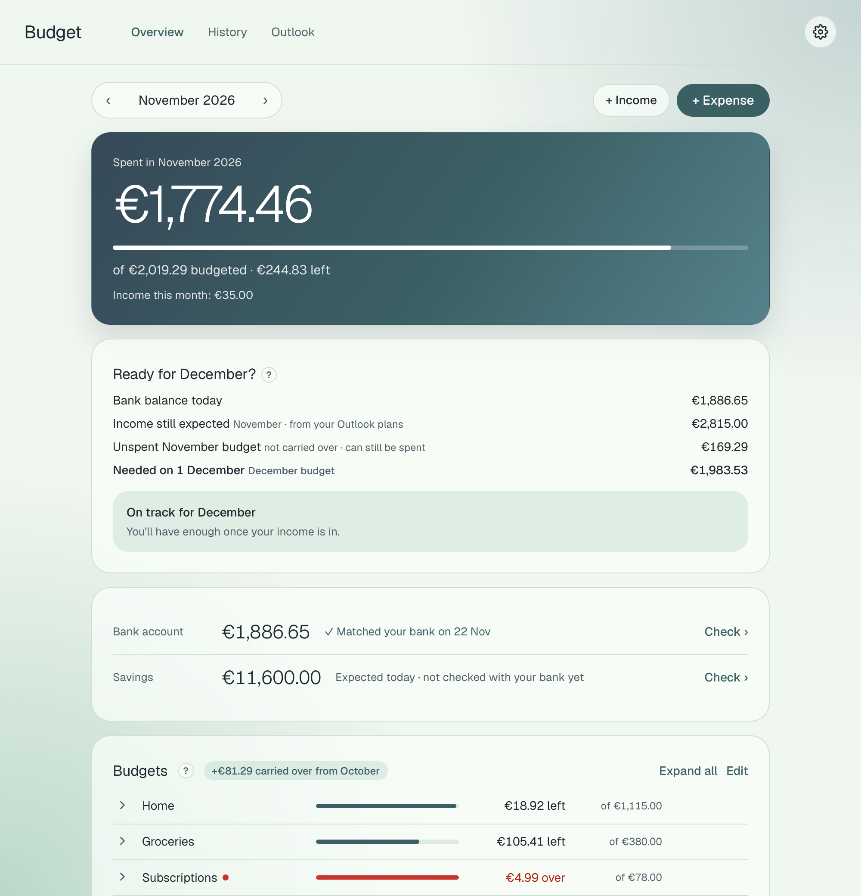
</picture>

### Ready for next month?

In the last week of the month, Budget compares your bank balance, plus the income you still expect this month, with what next month needs and tells you exactly how much is short or spare. Once your income is in, one click moves the difference to or from your savings.

### Budgets that fit real life

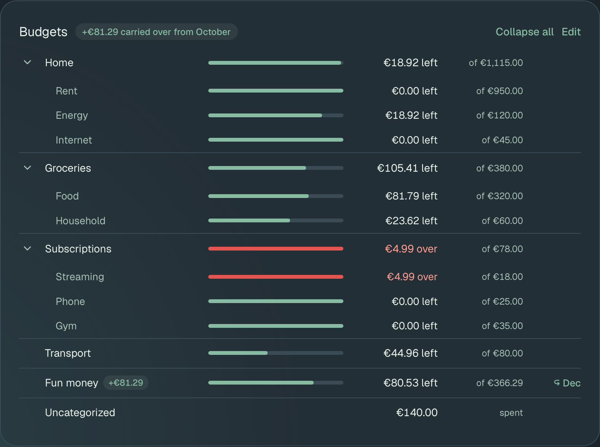

- **Categories and items**, such as Home › Rent, Energy and Internet, or a single budget like Fun money.
- **Budgets that change over time.** Raise the rent from next month and earlier months stay exactly as they were.
- **Carry leftovers over** to next month, by default or case by case, and see how much came along.
- **Split a budget into items later.** Turn Groceries into Food and Household from this month on; the months before keep the single budget they had.

### Split a purchase, or pay a bill early

<table>
<tr>
<td width="50%">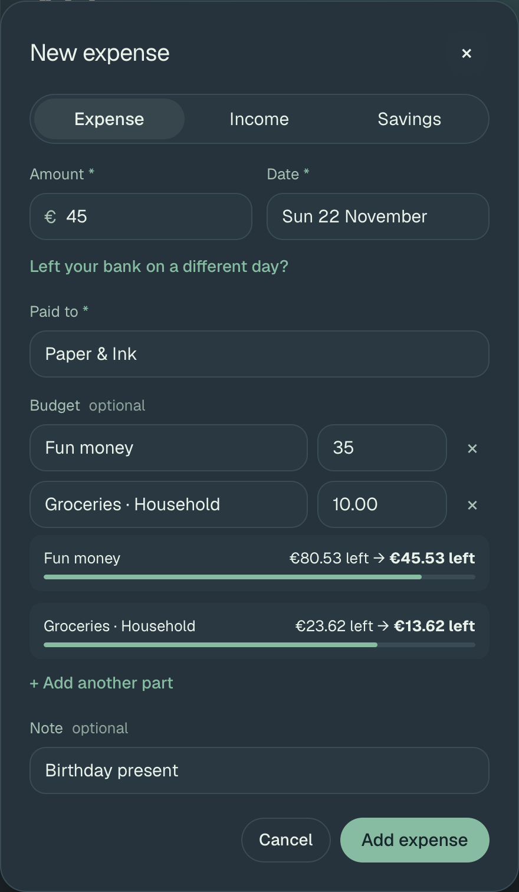</td>
<td>

- **Split** one purchase across several budgets, and see the effect on each.
- **Bills paid in advance** can count for one month and leave your bank in another.

</td>
</tr>
</table>

### Keep your balances honest

<table>
<tr>
<td>

Set a starting balance for your bank account and savings, and Budget keeps track from there. Enter what your bank shows at any time: it tells you whether everything matches, or how much is off.

</td>
<td width="50%">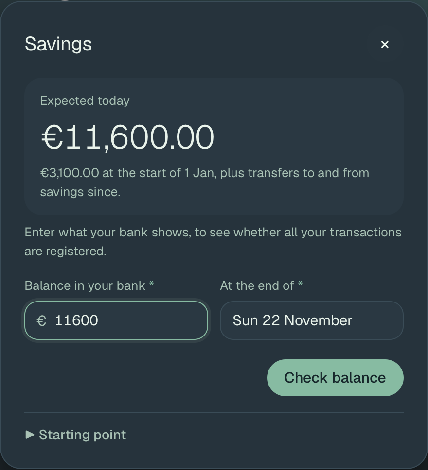</td>
</tr>
</table>

### Look ahead with the Outlook

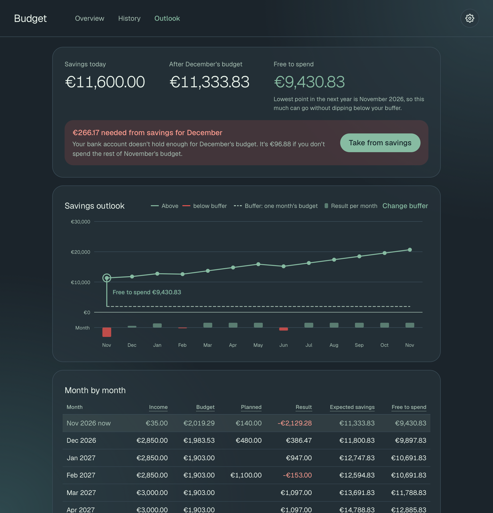

Add your expected income and planned costs, like a holiday or a new laptop, once, monthly, or every few months (like tuition paid every other month), and Budget projects your savings for the next 12 months. If your bank account won't cover next month's budget, it tells you how much to take from your savings. It keeps a safety buffer in your savings and shows how much you can **freely spend** without dipping below it in any month ahead. The chart marks the lowest point ahead, so you can see where that amount comes from, and small bars show what each month adds or takes. You choose the buffer: a number of months of budget, or a fixed amount.

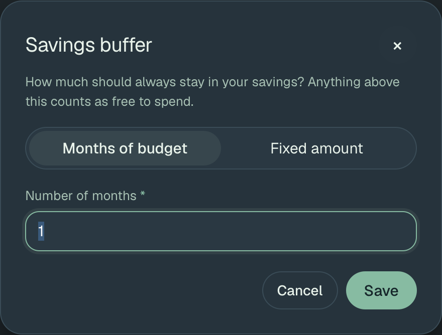

## Settings, backups and updates

### Make it yours

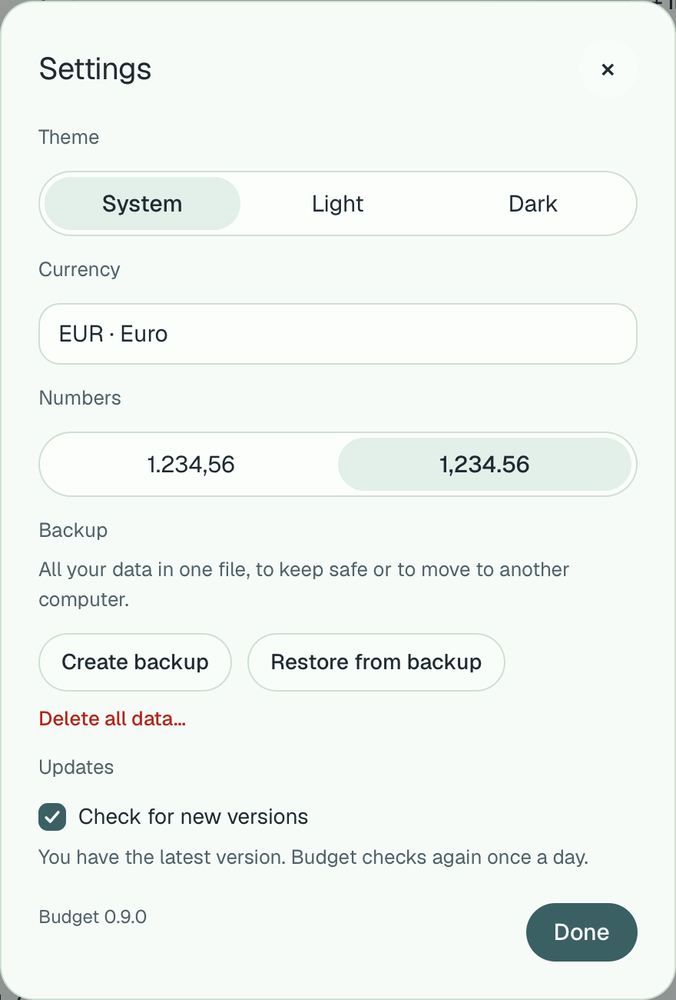

Budget speaks English and Dutch: it follows your computer's language, or the one you choose. Choose **Simple** or **Extended** mode. Follow your computer's light or dark mode, or choose one yourself, and pick your currency from every currency in the world. Numbers are written the way your computer writes them, or the way you choose: 1.234,56 or 1,234.56. Amounts you type, and the examples in messages, follow the same choice.

### Backups and moving to a new computer

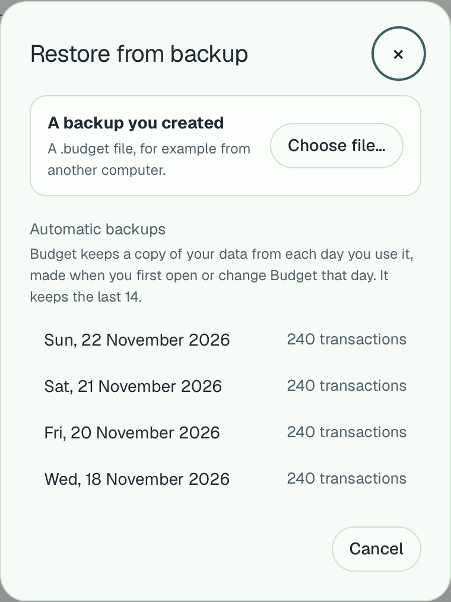

**Create backup** saves all your data in one file, to keep safe or to move to a new computer, Mac or Windows. Budget also keeps an automatic backup of each day you use it, the last 14. **Restore from backup** brings back either one: it checks the file first, shows what's in it and what it replaces, and offers to create a backup of your current data before it does.

**Delete all data** empties Budget, for a fresh start. It only goes ahead after you create a backup, or tick that you don't need one, and it can't be undone.

### Hear about new versions

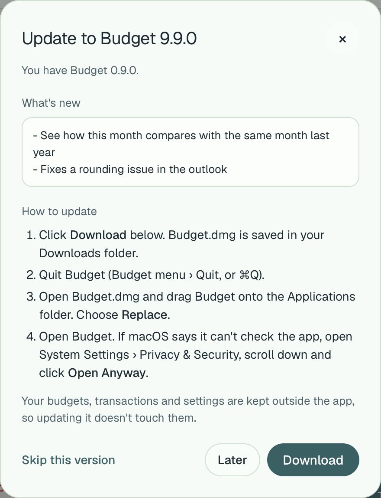

Once a day Budget asks GitHub whether there's a new version. Only GitHub is asked, and nothing about you or your data is sent. When there is one for your system, a banner at the top says so, and **How to update** shows what's new and how to install it on your Mac or Windows PC. Settings shows whether you have the latest version, and you can turn the check off there with **Check for new versions**.

## Installing

Download Budget from the [Releases](../../releases) page: `Budget.dmg` for a Mac, `Budget-setup.exe` for Windows. Nothing else needs to be installed.

### On a Mac

1. Open `Budget.dmg` and drag **Budget** to **Applications**.
2. Open Budget.

Budget isn't signed with a paid Apple Developer account, so the first time, macOS says it can't open it. Click **Done**, then allow it once:

1. Open **System Settings** and choose **Privacy & Security** in the sidebar.
2. Scroll all the way down to **Security**. Next to "“Budget” was blocked to protect your Mac", click **Open Anyway**.
3. Confirm with your password or Touch ID, and choose **Open Anyway** once more.

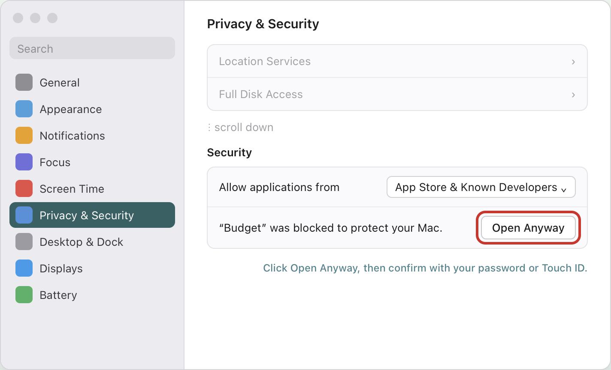

The button only shows for about an hour after macOS blocked Budget. If it isn't there, open Budget again first. You do this again after installing a new version.

To update, quit Budget, download the new `Budget.dmg`, drag Budget to **Applications** again and choose **Replace**. Your data is kept outside the app, so it stays as it is.

Budget runs on Macs with Apple Silicon.

### On Windows

1. Open `Budget-setup.exe` and follow the steps. Budget installs for you only, so no administrator is needed.
2. Open Budget from the Start menu.

Budget isn't signed with a paid certificate yet, so Windows may say it protected your PC. Click **More info**, then **Run anyway**. Your browser may also ask whether to keep the download: choose **Keep**.

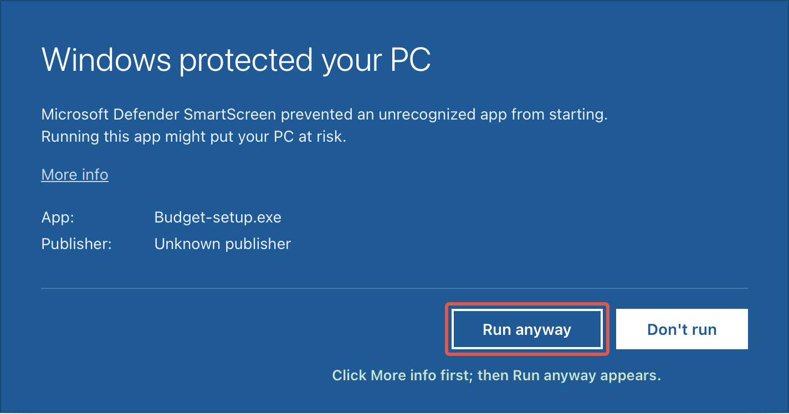

To update, download the new `Budget-setup.exe` and open it: it closes Budget, installs the new version and opens it again. To remove Budget, use **Settings → Apps → Installed apps**. Your data is kept outside the app, so updating or removing it doesn't touch your data.

Budget runs on 64-bit Windows 10 and 11.

### Getting started

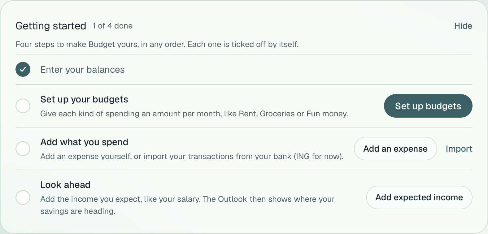

A new Budget is empty and in Simple mode. The Overview shows two steps: set up your budgets, starting from your income (Budget suggests common ones), and add what you spend, by hand or from your bank. Each step is ticked off by itself, and the guide goes away when both are done. **Hide** puts it away sooner. Your bank balance and the rest are offered once they're useful. In Extended mode, entering your bank balance is a step too.

## Your data

Everything stays on your computer:

- **Mac:** `~/Library/Application Support/nl.hendrikdemir.budget`
- **Windows:** `%APPDATA%\Budget`

Budget makes a backup automatically on each day you use it and keeps the last 14, in the `backups` folder there. You can restore them from **Settings → Restore from backup**. They're on the same computer, so for a copy elsewhere, use **Create backup** (or Time Machine on a Mac).

**Moving to a new computer**

1. On your old computer, open Budget, click the gear icon to open **Settings**, and choose **Create backup**. Save the file.
2. Move the file to your new computer, for example with AirDrop or a USB stick.
3. Install Budget there, open **Settings**, choose **Restore from backup**, and then **Choose file…**.

A backup works on both systems, so you can also move from a Mac to Windows or the other way around.

The backup file holds all your financial data and isn't encrypted, so keep it somewhere safe and delete it when you no longer need it.

## For developers

Budget is a small Python and JavaScript app. It uses SQLite and only the Python standard library, with no web build step.

Run it from source in your browser, with separate data in this folder:

```bash
python3 server.py
```

Then open http://localhost:8000.

Add `--demo` to try it with a made-up household, kept in `.demo-data/`. Add `--empty` to see it as a new user does, without any data: it starts empty every time.

To try the update check without a real release, point it at a made-up one:

```bash
BUDGET_RELEASES_URL=packaging/test-release.json python3 server.py --demo
```

Build `dist/Budget.app` and `dist/Budget.dmg` on a Mac:

```bash
packaging/build.sh
```

Build `dist\Budget-setup.exe` on Windows, with Python 3 and [Inno Setup 6](https://jrsoftware.org/isinfo.php) installed:

```powershell
packaging\build-windows.ps1
```

You don't need a Windows computer for this: every push to `main` and every release tag is built and tested on Windows by GitHub (`.github/workflows/windows.yml`). The installer is in the run's Artifacts.

On a Mac, build and replace the copy in Applications (your data isn't affected):

```bash
packaging/install.sh
```

Run the tests:

```bash
python3 -m unittest
```

Run every check, as GitHub does for each push: the tests with the page tests in WebKit, ruff for
the Python, and type checks and ESLint for the page. The first run installs what they need (into
`.venv-build/` and `node_modules/`; the app itself needs none of it):

```bash
packaging/check.sh
```

Release a new version:

```bash
python3 packaging/release.py
```

It checks that everything is committed and the tests pass, suggests a patch, minor or major version from what changed since the last release, and drafts release notes for you to edit. It asks which systems the release is for: both, or only the Mac or Windows for a fix that only matters there (apps only hear about releases with a file for their own system). It then builds `Budget.dmg` for you to try, tags and pushes the release, waits for GitHub's Windows build of the tag and downloads `Budget-setup.exe` for you to try, and publishes the release on GitHub with the [`gh`](https://cli.github.com) tool. Add `--dry-run` to only see the suggested version. Write `BREAKING` in a commit message to make the next release a major one. Apps on an older version show the new one within a day.

Texts are in `static/lang/<code>.json` under named keys, in [i18next](https://www.i18next.com)'s JSON format; `en.json` is the source. To add a language, add its file and list it in `static/js/i18n.js` and `app/i18n.py`. The tests check that every language has every text:

```bash
python3 -m tests.test_i18n nl  # what Dutch is still missing
```

Update the screenshots, using made-up data:

```bash
.venv-build/bin/python packaging/make_screenshots.py
```

| Path | Contents |
| --- | --- |
| `desktop.py` | The desktop app (Mac and Windows): starts the server and opens the window |
| `server.py` | Starts the server for development |
| `app/` | Server side: database, budgets, balances, outlook, bank imports, backups and API |
| `static/` | The page: HTML, CSS, JavaScript modules and the language files (`lang/`) |
| `packaging/` | App builds (Mac and Windows installer), icon, release script and screenshots |
| `tests/` | Tests for the calculations, bank imports, the server, the languages and the page (in WebKit) |

## License

Copyright © 2026 Hendrik Demir

Budget is free software: you can use it for any purpose, and share and change it under the terms of the [GNU General Public License, version 3](LICENSE) or later. If you share a changed version, you share its source code under the same license too. Budget comes with no warranty.
